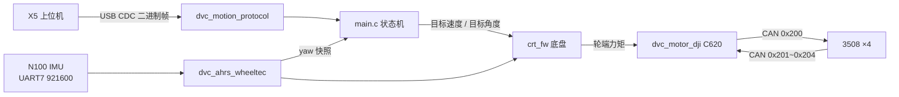
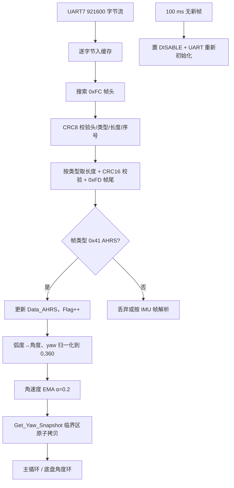
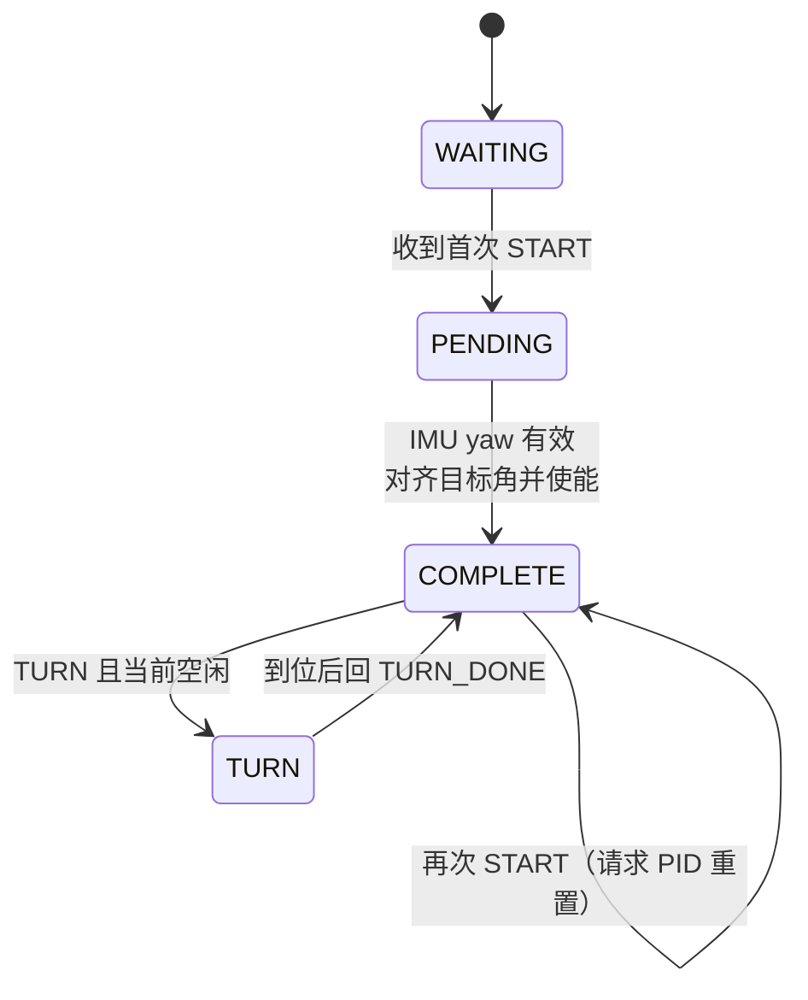

# RoboCup 四轮差速底盘运动控制固件

基于 **DMmc02 主控板**（**STM32H723VGT6**）的四轮差速底盘下位机固件，围绕三件事展开：

1. **DJI 3508 + C620 四轮差速底盘的运动学与动力学解算**；
2. **轮趣 N100 IMU 参与的航向角锁定**（角度制 yaw 闭环，直行保航向、定角转向）；
3. **yaw 轴数据处理**（协议解析、CRC 校验、单位与范围归一化、突变补偿、失效判定）。

上位机（X5）通过 **USB CDC 虚拟串口** 以二进制协议 `MOTION_PROTOCOL V2.1` 下发速度、停止、转向与启动命令，下位机回传转向完成回执。

---

## 1. 硬件平台

| 项目 | 参数 | 说明 |
| --- | --- | --- |
| 主控板 | DMmc02 | 板载 2 路 24 V、1 路 5 V 可控电源输出、蜂鸣器、USB、FDCAN |
| MCU | STM32H723VGT6 | Cortex-M7，LQFP100，最高 550 MHz |
| 系统时钟 | HSE 24 MHz → PLL1 | SYSCLK 550 MHz，HCLK 275 MHz，APB1~4 137.5 MHz |
| 外设时钟 | PLL2 | FDCAN 120 MHz，SPI2 80 MHz；USB 走 PLL3，48 MHz |
| 电机 | DJI 3508 ×4 + C620 电调 | FDCAN3 @ 1 Mbit/s |
| 姿态传感器 | 轮趣 N100 | UART7 @ 921600，二进制帧（0xFC 帧头 / 0xFD 帧尾） |
| 上位机接口 | USB CDC（全速） | 运动协议收发 + 转向完成回执 |
| 其他 | SPI2、TIM5、TIM12、USART10 | 时间戳基准、蜂鸣器 PWM 等 |

---

## 2. 功能特性

- **正/逆运动学解算**：由四轮反馈角速度推算底盘线速度与 yaw 角速度，由目标线速度与航向角速度反解四轮目标转速。
- **动力学解算与力矩输出**：速度环 PID 输出轮端目标力矩（限幅 ±1.2 N·m），经减速比与扭矩常数换算为 C620 电流指令（±20 A 对应 ±16384 刻度），并附带电机功率估算。
- **航向角锁定**：以 N100 yaw（角度制）为反馈的外层角度环，输出底盘目标 yaw 角速度，实现直行保航向与相对定角转向。
- **yaw 数据可靠性处理**：CRC8/CRC16 双校验、弧度→角度换算、`[0, 360)` 归一化、角速度 EMA 滤波、同帧原子快照、360°→0° 突变补偿、100 ms 存活检测与断线重连。
- **运动协议 V2.1**：半包/粘包/噪声自适应重组，CRC-16/Modbus 校验，非法帧统计。
- **状态机与安全策略**：上电保持失能，首次 `START` 等 IMU 有效后才使能；`STOP` 保留航向目标；`START` 支持 PID 重置。

---

## 3. 软件架构

```text
Core/Src/main.c                     初始化、主循环、状态机、yaw 突变补偿
Code/
├── 1_Middleware/
│   ├── 1_Driver/{CAN,UART,USB,SPI} 外设驱动（FDCAN、DMA 串口、USB CDC）
│   ├── 2_Algorithm/
│   │   ├── PID                       通用 PID（限幅、死区、微分先行、变速积分）
│   │   ├── Filter、Matrix、Quaternion、Basic
│   │   └── ...
│   └── 3_System/Timestamp           TIM5 1 MHz 计时，微秒级时间戳
├── 2_Device/
│   ├── Motor/Motor_DJI              3508/C620、GM6020、C610 驱动与功率模型
│   ├── AHRS/AHRS_WHEELTEC           轮趣 N100 解析、yaw 快照、存活检测
│   ├── ROS/dvc_motion_protocol      USB 二进制运动协议（V2.1）
│   └── BSP/{Power,Buzzer,BMI088,…}
└── 3_Chariot/1_Module/
    ├── Chassis/Four_whell           四轮差速底盘：运动学、动力学、控制输出
    └── Music                        开机提示音
```

数据流：



---

## 4. 坐标系与角度约定

机器人坐标系：`x` 轴向前为正，`y` 轴向左为正，`z` 轴向上为正，角速度 `ω` 逆时针为正。

轮组编号（俯视，代码索引 `[0]~[3]`）：

```text
1[0]   4[3]
2[1]   3[2]
```

左右两侧电机安装方向相反，因此逆解中右侧（`[2]`、`[3]`）的平移项取负号，而航向项四个轮子符号相同。

N100 实测欧拉角约定：

| 角度 | 变化规律 | 处理方式 |
| --- | --- | --- |
| `Yaw` | 逆时针增大，`360 → 0` 处突变 | `[0, 360)` 归一化；误差计算统一取最短角 |
| `Pitch` | `0 → -90 → 0 → 90 → 0` | 仅透传，不参与底盘控制 |
| `Roll` | `0 → -180 ⤶ 180 → 0` | 仅透传，不参与底盘控制 |

对外接口统一输出**角度制**。

---

## 5. 核心算法

### 5.1 运动学正解（`Class_Chassis_FW::Self_Resolution`）

由四轮实际角速度 $\omega_0 \sim \omega_3$ 解算底盘状态：

$$
v_x = \frac{R}{4}\,(\omega_0 + \omega_1 - \omega_2 - \omega_3)
$$

$$
\omega_z = -\frac{R}{4 L_y}\,(\omega_0 + \omega_1 + \omega_2 + \omega_3)
$$

其中 $R = 0.0525\ \text{m}$ 为轮半径，$L_y = 0.150\ \text{m}$ 为轮组投影点 y 坐标（有效轮距 $2L_y = 0.30\ \text{m}$）。横向速度 `Now_Velocity_Y` 未启用。

### 5.2 运动学逆解（`Kinematics_Inverse_Resolution`）

由目标线速度 $v_x^{ref}$ 与航向环解算出的目标角速度 $\omega_z^{ref}$ 反解四轮目标转速：

$$
\omega_x = \frac{v_x^{ref}}{R}, \qquad \omega_\psi = \frac{\omega_z^{ref} L_y}{R}
$$

$$
\omega_0^{ref} = \omega_1^{ref} = +\omega_x - \omega_\psi, \qquad
\omega_2^{ref} = \omega_3^{ref} = -\omega_x - \omega_\psi
$$

底盘失能时四轮目标转速直接置 0。

### 5.3 动力学解算与力矩输出

每个轮子独立闭环，`速度环 → 力矩 → 电流`：

```text
目标转速(rad/s) ──► PID_Omega ──► 目标力矩(N·m) ──► 电流指令 ──► CAN 0x200 ──► C620
        ▲                                    （限幅 ±1.2 N·m）
   实际转速 ◄────────────── 编码器反馈（CAN 0x201~0x204）───────────────┘
```

- 速度环 PID：`Kp = 0.41`、`Ki = 0.15`、`Kd = 0`，控制周期 2 ms，输出（力矩）与积分均限幅 ±1.2 N·m。
- 力矩电流换算：`Out = (τ + τ_ff) / k_t / i × 819.2`，其中 $k_t = 0.3/19.2\ \text{N·m/A}$（减速前）、减速比 $i = 3591/187 \approx 19.20$、电流刻度 $16384/20\ \text{A}$。即 **1.2 N·m 对应 4 A 电流指令**。
- 反馈折算：`Now_Torque = I × 0.3`（输出轴）、`Now_Power` 由厂家拟合系数 `K0·τω + K1·ω² + K2·τ² + A` 估算。
- 失能流程：切到力矩模式、目标力矩置 0、清零速度环状态，保证电机输出为 0 而不是保持上一帧指令。

### 5.4 航向角锁定（`Resolve_Target_Omega`）

航向控制有两种模式：`OMEGA`（直接给角速度）与 `ANGLE`（角度闭环）。本工程固定使用 `ANGLE`：

$$
e_\psi = \operatorname{wrap}_{[-180°,180°)}(\psi^{ref} - \psi^{now})
$$

$$
\omega_z^{ref} = \mathrm{PID}_{\psi}(e_\psi)
$$

- 角度环参数：`Kp = 0.35`、`Ki = 0`、`Kd = 0.0011`、死区 `0.01°`、输出限幅 `±1.2 rad/s`、周期 2 ms（内环为速度/力矩环）。
- 角度环输入用**最短角误差**，天然兼容 yaw 的 `360 → 0` 突变。
- 目标角在 `Set_Attitude_Feedback` 首次收到有效姿态时自动对齐当前 yaw；IMU 失效时 `Target_Angle_Initialized` 清零、角速度目标置 0，恢复后重新对齐，避免失效期间积分残留带来甩头。
- 直行时 `v_x ≠ 0` 且 `ω_z` 由角度环产生，实现"直行保航向"；转向时线速度为 0，纯角度闭环。

### 5.5 yaw 数据处理链路



要点：

- **帧结构**：`0xFC | 类型 | 长度 | 序号 | CRC8 | CRC16(H,L) | DATA | 0xFD`，CRC8 覆盖前 4 字节，CRC16 覆盖数据区（`0x40` 为原始 IMU 帧，`0x41` 为 AHRS 帧）。
- **半包/粘包/噪声**：接收回调把字节追加进 `Rx_Stream_Buffer`，每进一字节尝试解一次完整帧；校验失败只丢 1 字节重新搜索帧头，不会丢整段数据。
- **单位与范围**：N100 原始欧拉角为弧度，接口层统一换算为角度；`Yaw` 归一化到 `[0, 360)` 并修正 `360` 与 `-0` 边界值。
- **同帧一致性**：`Get_Yaw_Snapshot()` 在关中断临界区内一次性复制 yaw、yaw 角速度与帧计数，避免主循环读到"半新半旧"的两帧数据；换算与滤波在开中断后进行，缩短临界区。
- **角速度滤波**：yaw/roll/pitch 三轴角速度各用一阶 EMA（`α = 0.2`），输出保留三位小数。
- **失效判定**：每 100 ms 检查帧计数是否增长，不增长即判定 IMU 断开并重新初始化串口；上层立即停止使用该 yaw，`Valid = false`。

### 5.6 直行 yaw 突变补偿（`Main_Compensate_Straight_Yaw_Jump`）

即使有最短角误差，直行时若单帧 yaw 出现跳变（例如融合重收敛），角度环仍会产生一次阶跃误差。补偿策略：

1. 仅在"已启动 + 未转向 + 车速非零 + 角度模式"时建立基准；
2. 同帧不重复处理（用 `Frame_Count` 去重），采样间隔超过 `20 ms` 只重建基准；
3. 相邻有效帧的最短角增量 $|\Delta\psi| > 3°$ 时，把**目标角同向平移同一增量**：

$$
\psi^{ref}_{k} = \operatorname{wrap}_{[-180°,180°)}(\psi^{ref}_{k-1} + \Delta\psi)
$$

4. 平移后误差连续，**不重置 PID**，不会产生积分/微分冲击；停车、转向、IMU 无效时立即清基准。

调试变量 `Yaw_Jump_Compensation_Count`、`Last_Yaw_Jump_Deg` 可直接在调试器中观察补偿次数与幅度。

### 5.7 控制时序

| 周期 | 动作 | 说明 |
| --- | --- | --- |
| 主循环（`HAL_Delay(0)`，实际 1 ms） | 读取 yaw 快照、更新状态机、yaw 突变补偿、CAN 发帧 | 每轮循环执行一次 |
| 每 2 次循环（≈ 2 ms） | `Self_Resolution` → `Resolve_Target_Omega` → `Kinematics_Inverse_Resolution` → `Output_To_Motor` | 与 PID 的 `D_T = 2 ms` 对应 |
| 每 100 次循环（≈ 100 ms） | N100 存活检测、电机存活检测 | 超时即置失效 |
| TIM5（1 MHz，ARR = 3.6e9） | 1 小时溢出一次，提供 64 bit 微秒时间戳 | `sys_timestamp` |

> 注意：`HAL_Delay(n)` 在本工程语义下实际延时 `(n + 1) ms`，因此 `HAL_Delay(0)` 是 1 ms 延时，主循环节拍按 1 ms 计算。

---

## 6. 通信协议（MOTION_PROTOCOL V2.1）

物理层为 **USB CDC 虚拟串口**（上位机按串口设备打开），帧格式：

| 偏移 | 字段 | 长度 | 说明 |
| --- | --- | --- | --- |
| 0 | 帧头 | 2 B | 固定 `AA 55` |
| 2 | CMD | 1 B | 命令字 |
| 3 | LEN | 1 B | DATA 字节数 |
| 4 | DATA | N B | 由命令字决定 |
| 4+N | CRC | 2 B | CRC-16/Modbus（初值 `0xFFFF`，多项式 `0xA001`），低字节先发 |

CRC 计算范围为 `CMD + LEN + DATA`，**不含帧头**。

| CMD | 方向 | 命令 | LEN | DATA |
| --- | --- | --- | --- | --- |
| `0x01` | 上位机 → 下位机 | 速度 `VEL` | 8 | `linear_x`(m/s) + `angular_z`(rad/s)，均为 float32 小端 |
| `0x02` | 上位机 → 下位机 | 停止 `STOP` | 0 | 无 |
| `0x03` | 上位机 → 下位机 | 定角转向 `TURN` | 4 | `angle_deg`(deg)，相对当前方向的转角，范围 `[-130, 130]` |
| `0x04` | 上位机 → 下位机 | 启动 / PID 重置 `START` | 0 | 无 |
| `0x83` | 下位机 → 上位机 | 转向完成 `TURN_DONE` | 0 | 固定帧 `AA 55 83 00 60 80` |

示例：右转 90° 的完整帧为 `AA 55 03 04 00 00 B4 C2 07 79`。

> 角度闭环模式下 `angular_z` 不参与控制，航向由 yaw 角度环决定；`TURN` 的角度闭环完成判据为
> `|e_ψ| ≤ 1°` 且 `|ω_yaw| ≤ 0.05 rad/s` 且 `|v_x| ≤ 0.02 m/s`。

---

## 7. 运行状态机



- **上电失能**：初始化完成后保持 `DISABLE`，必须收到本次上电的首次 `START` 才使能，避免上电误动。
- **`START` 二义**：首次推进启动流程，之后只请求清零 PID（`Reset_Control_PID` 同时清零航向/轮速 PID 并下发一帧零力矩）。
- **`STOP`**：平移速度清零、取消转向状态，但**不改变已锁定的航向目标**，避免停车瞬间重新锁定当前 yaw。
- **`TURN`**：目标角 = 当前 yaw + 相对角，并归一化到 `[-180°, 180°)`；期间线速度强制为 0。

---

## 8. 关键参数

| 参数 | 数值 | 位置 |
| --- | --- | --- |
| 轮半径 $R$ | 0.0525 m | `crt_fw.h` |
| 轮组投影 x | 0.100 m（轴距 0.20 m） | `crt_fw.h` |
| 轮组投影 y | 0.150 m（轮距 0.30 m） | `crt_fw.h` |
| 减速比 | 3591/187 ≈ 19.20 | `crt_fw::Init` |
| 编码器分辨率 | 8192 / 圈 | `dvc_motor_dji.h` |
| 扭矩常数 | 0.3 N·m/A（输出轴） | `dvc_motor_dji.h` |
| 轮端力矩限幅 | ±1.2 N·m（≈ ±4 A） | `Wheel_Torque_Max` |
| 电流输出刻度 | ±16384 ↔ ±20 A | `CURRENT_TO_OUT` |
| 轮速环 PID | Kp 0.41 / Ki 0.15 / Kd 0，2 ms | `crt_fw::Init` |
| 航向环 PID | Kp 0.35 / Ki 0 / Kd 0.0011，死区 0.01°，±1.2 rad/s，2 ms | `crt_fw::Init` |
| yaw 突变阈值 | > 3°，采样间隔 ≤ 20 ms | `main.c` |
| 转向完成判据 | 1° / 0.05 rad/s / 0.02 m/s | `main.c` |
| 转向角范围 | `[-130, 130]` deg | `dvc_motion_protocol.h` |
| FDCAN | 1 Mbit/s，反馈 `0x201~0x204`，指令 `0x200` | `robocup.ioc` / `drv_can.cpp` |
| N100 串口 | UART7，921600，8N1 | `robocup.ioc` |

---

## 9. 构建与烧录

工具链与构建系统：

- CMake ≥ 3.22、Ninja
- Arm Clang 工具链（`cmake/starm-clang.cmake`，`STARM_PICOLIBC` 配置）；另附 `cmake/gcc-arm-none-eabi.cmake`
- STM32CubeMX 生成的 HAL 通过 `cmake/stm32cubemx` 子目录纳入构建，`main.c` 以 C++ 编译

```bash
cmake --preset Debug
cmake --build --preset Debug
# Release
cmake --preset Release
cmake --build --preset Release
```

产物位于 `build/<Preset>/robocup.elf`，链接脚本 `STM32H723xG_flash.ld`，使用 ST-Link（STM32 VS Code 扩展或 CubeProgrammer）烧录。

---

## 10. 设计说明与文档

更多细节见 `.doc/`：

| 文档 | 内容 |
| --- | --- |
| [`MOTION_PROTOCOL.md`](.doc/MOTION_PROTOCOL.md) | 上位机-下位机运动协议完整定义 |
| [`MOTION_PROTOCOL_USAGE.md`](.doc/MOTION_PROTOCOL_USAGE.md) | 协议使用与联调 |
| [`main_c_detailed_explanation.md`](.doc/main_c_detailed_explanation.md) | 主循环与状态机逐段说明 |
| [`imu_yaw_unwrap_guide.md`](.doc/imu_yaw_unwrap_guide.md) | yaw 解卷绕与最短角处理 |
| [`IMU_TIMING_EKF_MAIN_MERGE_GUIDE.md`](.doc/IMU_TIMING_EKF_MAIN_MERGE_GUIDE.md) | IMU 时序与 EKF 接入说明 |
| [`bmi088_initialization_and_euler_api.md`](.doc/bmi088_initialization_and_euler_api.md) | 板载 BMI088 初始化与欧拉角 API |

主要设计取舍：

- **角度制 + 最短角误差**：所有跨 360° 比较都走 `wrap` 处理，避免 `360 → 0` 突变引起控制抖动。
- **同帧快照**：yaw 与 yaw 角速度必须来自同一帧，否则角度环的 D 项会被两帧错位污染。
- **不在回调里做重活**：USB/UART 回调只做解析与拷贝，换算、滤波、控制都在主循环执行。
- **失效即零输出**：IMU 或电机掉线后角度环输出清零并等待重新对齐，不做"用旧角度硬撑"。

---

## 11. 致谢

工程结构沿用 **USTC-RoboWalker** 的嵌入式框架（`Class_PID`、设备抽象、CAN/UART/USB 驱动设计），在此基础上扩展了四轮差速底盘解算、N100 航向锁定与运动协议实现。
